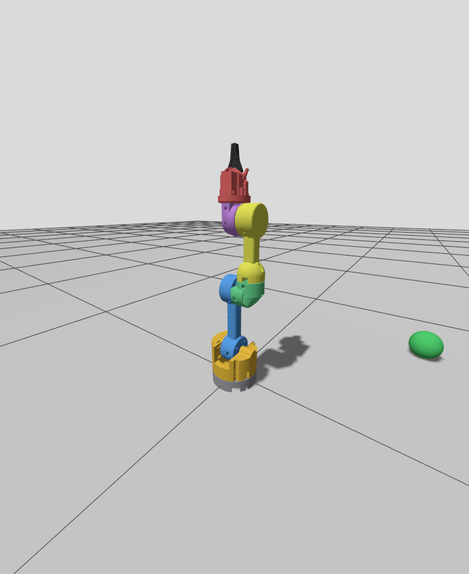

# rk6 — 6 DoF Robot Kol (ROS 2 Lyrical + Gazebo Jetty)

BLMU7619 Robot Teknolojileri vize projesi. `rk6`, kendi tasarımım olan 6 döner eklemli bir seri robot koldur: Fusion 360'ta tasarlandı, URDF/Xacro ile modellendi, Gazebo Jetty'de simüle edildi ve ROS 2 Lyrical üzerinden kontrol edildi.



- **Geometrik sınıf:** R ⊢ R ∥ R (articulated), 6 DoF, kaçıklıklı bilek
- **Model:** Fusion 360 tasarımından çıkarılan kinematik (DH), birleşik link mesh'leri, kütle ve atalet değerleri
- **Rapor:** [`rapor/4801260209.pdf`](rapor/4801260209.pdf) (kaynağı: [`rapor/rapor_taslak.md`](rapor/rapor_taslak.md))

## Gereksinimler

Kod **ROS 2 Lyrical + Gazebo Jetty** ile, Windows 11 üzerinde **WSL2 (Ubuntu 26.04)** ortamında test edildi.

- Ubuntu 26.04 (doğrudan ya da WSL2)
- ROS 2 Lyrical (`ros-lyrical-desktop`, `ros-dev-tools`)
- Gazebo Jetty ve köprüler: `ros-lyrical-ros-gz`, `ros-lyrical-gz-ros2-control`
- `ros-lyrical-ros2-control`, `ros-lyrical-ros2-controllers`, `ros-lyrical-xacro`, `ros-lyrical-robot-state-publisher`, `ros-lyrical-joint-state-publisher-gui`, `ros-lyrical-rviz2`, `ros-lyrical-cv-bridge`, `ros-lyrical-rqt-image-view`, `ros-lyrical-tf2-tools`
- Python: `python3-numpy`, `python3-matplotlib`, `python3-opencv`

## Kurulum

**Yol 1 — Elle (ROS 2 Lyrical ve Gazebo Jetty kuruluysa):**

```bash
mkdir -p ~/rt_ws/src && cd ~/rt_ws/src
git clone https://github.com/mahmutkucukakyuz-iuc/robotik_vize.git rk6        # colcon paketleri rk6/ros2_ws/src altında kendisi bulur
source /opt/ros/lyrical/setup.bash
cd ~/rt_ws && colcon build --symlink-install && source install/setup.bash
```

Derleme sonunda `Summary: 3 packages finished` görünmelidir.

**Yol 2 — Kurulum betiği (sıfırdan Ubuntu 26.04 / WSL2):** [`kurulum_wsl.sh`](kurulum_wsl.sh) ROS 2 Lyrical, Gazebo Jetty ve bağımlılıkları kurar, `~/.bashrc`'ye ROS ortamını ve WSL ekran kartı ayarlarını ekler, paketleri `~/rt_ws` içinde derler:

```bash
bash <depo_klasoru>/kurulum_wsl.sh
```

Kurulumdan sonra her yeni terminal `~/.bashrc` üzerinden `~/rt_ws/install/setup.bash`'i yükler; yüklenmediyse `source ~/rt_ws/install/setup.bash` çalıştırın. Ödev kısmı ile ekstra senaryo aynı anda çalıştırılmaz. Adım adım anlatım, argümanlar, kontrol komutları ve sorun giderme için: [CALISTIRMA_KILAVUZU.md](CALISTIRMA_KILAVUZU.md)

## Ödevin istedikleri

Paketler: [`rk6_description`](ros2_ws/src/rk6_description) (model) ve [`rk6_control`](ros2_ws/src/rk6_control) (node'lar). Bu kısım ekstra paketi kullanmaz; o olmadan da derlenir ve çalışır.

- **Robot modeli:** URDF/Xacro, Fusion 360'tan gelen mesh'ler, kütle ve atalet değerleri, eklem limitleri, Gazebo dünyası
- **Sensörler:** bilek kamerası (`/wrist_camera/image_raw`), IMU (`/imu`), eklem durumları (`/joint_states`), uç efektör konumu (`/ee_pose`)
- **Kontrol:** `ros2_control` + `gz_ros2_control`; eklemler hem topic (`/arm_controller/joint_trajectory`) hem action (`/arm_controller/follow_joint_trajectory`) ile, radyan cinsinden
- **Düz kinematik hata analizi (T1–T10):** DH modeli ile Gazebo ölçümü arasındaki ortalama hata **0.245 µm**, standart sapma **0.137 µm** ([`rapor/sonuclar/fk_error_20261030_123836.md`](rapor/sonuclar/fk_error_20261030_123836.md))
- **3 konfigürasyon ve görselleştirme:** `motion_sequence` kolu Home → K1 → K2 → K3 → Home sırasıyla götürür; `visualizer` eklem açılarını canlı grafikte, kamera görüntüsünü ayrı pencerede gösterir

```bash
ros2 launch rk6_description gazebo.launch.py rviz:=true   # Terminal 1: simülasyon
ros2 launch rk6_control demo.launch.py                     # Terminal 2: Home → K1 → K2 → K3 → Home
ros2 launch rk6_control fk_analysis.launch.py              # Terminal 2: T1–T10 hata analizi
```

**Video:** [`video/rk6_vize_demo.mp4`](video/rk6_vize_demo.mp4)

## Ekstra çalışmalar

Paket: [`rk6_manipulation`](ros2_ws/src/rk6_manipulation) (ödev kapsamı dışında, ayrı senaryo ve kendi küplü dünyası).

- **Gripper:** iki parmaklı paralel gripper, metre cinsinden hedeflerle `gripper_controller` üzerinden açılıp kapanır
- **Ters kinematik:** Jacobian tabanlı sayısal çözücü (`ik.py`), `ik_goto` ile gripper'ı verilen noktaya götürme
- **Al-bırak:** `pick_place`, konumu bilinen küpleri alıp başka noktaya bırakır
- **Kamerayla tara ve diz:** `scan_and_stack`, bilek kamerasıyla zemindeki küpleri bulur ve robotun önüne üst üste dizer

```bash
ros2 launch rk6_manipulation stack_demo.launch.py          # tek komut: küplü simülasyon + tara ve diz
```

**Video:** [`video/rk6_ekstra_demo.mp4`](video/rk6_ekstra_demo.mp4)

## Rapor

[`rapor/4801260209.pdf`](rapor/4801260209.pdf): model, sınıflandırma, DH çerçeveleri, düz kinematik, hata analizi ve hareket görevi (§1–§6, §7); ekstra çalışmalar §6A ve §7.2b'de. Markdown kaynağı [`rapor/rapor_taslak.md`](rapor/rapor_taslak.md).

## Klasör yapısı

| Yol | Açıklama |
|---|---|
| [`ros2_ws/src/rk6_description`](ros2_ws/src/rk6_description) | URDF/Xacro modeli, mesh'ler, gripper, sensörler, kontrolcü ayarları, Gazebo dünyası ve launch dosyaları |
| [`ros2_ws/src/rk6_control`](ros2_ws/src/rk6_control) | Ödev node'ları: `ee_pose_publisher`, `motion_sequence`, `visualizer`, `fk_error_analysis` |
| [`ros2_ws/src/rk6_manipulation`](ros2_ws/src/rk6_manipulation) | Ekstra: ters kinematik, `ik_goto`, `pick_place`, `scan_and_stack`, küplü dünya |
| [`ros2_ws/README.md`](ros2_ws/README.md) | Paketlerin ve topic/action'ların ayrıntılı açıklaması |
| [`rk6_fk.py`](rk6_fk.py) | ROS'tan bağımsız DH düz kinematik betiği |
| [`rapor/`](rapor) | Proje raporu (PDF ve Markdown kaynağı), şekil betikleri, ölçüm sonuçları ve şekiller ([`rapor/sonuclar/`](rapor/sonuclar)) |
| [`video/`](video) | Demo videoları: ödev kısmı ve ekstra çalışmalar |
| [`CALISTIRMA_KILAVUZU.md`](CALISTIRMA_KILAVUZU.md) | Adım adım çalıştırma ve kontrol komutları |
| [`kurulum_wsl.sh`](kurulum_wsl.sh) | Windows + WSL2 (Ubuntu 26.04) için ROS 2 Lyrical / Gazebo Jetty kurulum betiği |

```
.
├── README.md
├── CALISTIRMA_KILAVUZU.md        # çalıştırma kılavuzu
├── kurulum_wsl.sh                # WSL2 kurulum betiği
├── rk6_fk.py                     # bağımsız DH FK
├── ros2_ws/src/
│   ├── rk6_description/          # urdf/, meshes/, config/, launch/, worlds/, rviz/
│   ├── rk6_control/              # ödev node'ları ve launch'ları
│   └── rk6_manipulation/         # ekstra: IK, algılama, al-bırak, dizme
├── rapor/
│   ├── 4801260209.pdf            # rapor
│   ├── rapor_taslak.md           # raporun kaynağı
│   ├── sekil*.py                 # şekil betikleri
│   └── sonuclar/                 # şekiller, FK hata tabloları, demo kayıtları
└── video/
    ├── rk6_vize_demo.mp4         # ödevin istedikleri
    └── rk6_ekstra_demo.mp4       # ekstra çalışmalar
```

Robotun Fusion 360 tasarımından URDF modeline nasıl aktarıldığı raporun §1.1 bölümünde anlatılır. URDF'in kullandığı link mesh'leri [`ros2_ws/src/rk6_description/meshes`](ros2_ws/src/rk6_description/meshes) altındadır.
