# BLMU7619 Robot Teknolojileri – Vize Projesi Raporu

**Öğrenci:** Mahmut KÜÇÜKAKYÜZ – 4801260209
**Öğretim görevlisi:** Dr. Öğr. Üyesi Nihal ALTUNTAŞ
**Robot:** rk6 – 6 serbestlik dereceli (6R) seri robot kol; iki parmaklı gripper, bilek kamerası ve IMU
**Ortam:** Ubuntu 26.04 LTS (WSL2), ROS 2 Lyrical, Gazebo Jetty
**GitHub reposu:** [github.com/mahmutkucukakyuz-iuc/robotik_vize](https://github.com/mahmutkucukakyuz-iuc/robotik_vize)
**Demo videoları:** Vize gereksinimleri: [rk6_vize_demo.mp4](https://github.com/mahmutkucukakyuz-iuc/robotik_vize/blob/main/video/rk6_vize_demo.mp4) · Ekstra çalışmalar: [rk6_ekstra_demo.mp4](https://github.com/mahmutkucukakyuz-iuc/robotik_vize/blob/main/video/rk6_ekstra_demo.mp4)

---

## 1. Robot Modeli ve Eklem Bağlantıları

`rk6`, hazır bir modelden (UR, Panda vb.) türetilmedi. Kol **Fusion 360'ta parça parça tasarlandı** (3B baskı gövde parçaları, DS3225 ve DS51150 servolar, iki parmaklı dişli gripper) ve fiziksel olarak da üretildi (Şekil 1a). Link boyutları, eklem dizilimi ve görünüm bu tasarıma aittir; simülasyondaki model, CAD tasarımının geometrisini ve kinematiğini doğrudan kullanır.

### 1.1 Fusion 360 tasarımından URDF modeline

Fusion montajı, eklem bilgileriyle (eklem tipi, ekseni ve noktası) birlikte dışa aktarıldı. Birbirine rijit bağlı parçalar, altı döner eklemin ayırdığı **link gruplarına** toplandı; her linkin parçaları tek bir STL'de birleştirilip o linkin kendi çerçevesine taşındı. Eklem eksenlerinden **sıfır poz** (kol dimdik yukarı) çıkarıldı; bu pozda eksenler 0.1 mm'den iyi hizalıydı ve model 0.01 mm'ye yuvarlanarak idealize edildi. Kütle, ağırlık merkezi, atalet ve çarpışma kutuları `urdf/rk6_mesh_props.xacro` dosyasındadır. Dışa aktarma pozunda düz kinematik, Fusion'daki eklem noktalarıyla 0.1 mm içinde örtüşür.

Link grupları (renkler simülasyondaki görünümdür):

| Link | Fusion parçaları | Renk | Kütle [kg] |
|---|---|---|---|
| `base_link` | Taban plakası (alt tabla) + J1 servo gövdesi (DS3225). CAD'deki 4 ayak simülasyonda çıkarıldı. | gri | 0.494 |
| `link1` | 18T horn + döner tabla (sol/sağ parça) + omuz servosu DS51150 | turuncu | 0.674 |
| `link2` | Üst kol (İlk Kol) + kapaklar + dirsek servosu | mavi | 0.421 |
| `link3` | 4. eksen alt gövde + J4 servosu | yeşil | 0.275 |
| `link4` | 4. eksen üst + ön kol (İkinci Kol) + kapak + bilek servosu | sarı | 0.350 |
| `link5` | 5. eksen parçaları + gripper döndürme servosu | mor | 0.199 |
| `link6` | Gripper tabanı, gövde, servo, dişliler | kırmızı | 0.245 |
| `gripper_left/right_finger` | Parmaklar (paralel kol mekanizması) | siyah | 0.020 + 0.020 |

### 1.2 Yapı

- **Linkler:** `base_link` (sabit taban), `link1` … `link6`.
- **Eklemler:** `joint1` … `joint6`. Altısı da **aktif döner (revolute, R)** eklemdir: bel (J1), omuz (J2), dirsek (J3), ön kol dönmesi (J4), bilek eğme (J5), gripper dönmesi (J6).
- **Taban:** Robot **doğrudan zeminde** durur. `world → base_link` sabit ekleminin yüksekliği 0'dır; `base_link` taban plakasının alt yüzeyindedir ve zeminle çakışır (taban altında yükseltici bir parça yoktur).
- **Uç-efektör:** `tool0` çerçevesi, parmakların iç tutma yüzeylerinin (pad) ortasındadır ve J6 ekseni üzerindedir. $z$ ekseni yaklaşma yönü, $y$ ekseni parmak açılma yönüdür. Kinematik referans (${}^0T_6$) bu çerçevedir.
- **Gripper:** Uçta iki parmaklı paralel gripper (bkz. §1.5). Vize metnine göre gripper DoF sayısına dahil değildir; robot 6 DoF'tur.
- **Aktüatörler:** Gerçek kolda servo motorlar; simülasyonda eklemler `gz_ros2_control` üzerinden **pozisyon komut arayüzü** ile sürülür.
- **Sensörler:**
  - Gripper gövdesinde bilek kamerası, `/wrist_camera/image_raw` (640×480, yatay görüş açısı 60°, ölçülen 30.3 Hz).
  - `link6` içinde IMU, `/imu` (ölçülen 100.0 Hz).
  - Eklem enkoderlerine karşılık `/joint_states` (ölçülen 100 Hz).
  - Uç efektörün tabana göre pozu `/ee_pose` (20 Hz).
- **Kontrolcü:** `joint_trajectory_controller` (adları `arm_controller` ve `gripper_controller`) ve `joint_state_broadcaster`.

### 1.3 Boyutlar

| Sembol | Değer [m] | Anlamı |
|---|---|---|
| $d_1$ | 0.1313 | Omuz yüksekliği: `base_link` (taban altı) → J2 ekseni |
| $a_2$ | 0.22995 | Üst kol: J2 ekseni → J3 ekseni |
| $d_3$ | 0.0652 | Dirsekteki yanal kaçıklık (J3 ekseni boyunca, $+y$) |
| $d_4$ | 0.22995 | Ön kol: J3 ekseni → J5 ekseni (J4 ekseni boyunca) |
| $d_5$ | −0.0660 | Bilekteki yanal geri dönüş (J5 ekseni boyunca) |
| $d_6$ | 0.20093 | J5 ekseni → `tool0` (gripper uzunluğu) |

Sıfır pozda toplam dik boy $d_1+a_2+d_4+d_6 = 0.79213$ m'dir. İki yanal kaçıklık neredeyse birbirini götürür: $d_3+d_5=-0.0008$ m.

### 1.4 Eklem bağlantı tablosu ve sıfır poz

**Sıfır poz ($q=0$): kol dimdik yukarı bakar.** Üst kol, ön kol ve gripper $+z_0$ yönündedir ve bu pozda bütün URDF link çerçeveleri `base_link`'e paraleldir (her eklemde `rpy = 0`). J1, J4, J6 kendi $z$ ekseni, J2, J3, J5 kendi $y$ ekseni etrafında döner. Pozitif $q_2$, $q_3$, $q_5$ kolu öne ($+x_0$) eğer.

Eksenler, sıfır pozda ve `base_link` = $\{0\}$ çerçevesine göre verilmiştir:

| Eklem | Tip | Parent → Child | URDF origin `xyz` [m] | Dönme ekseni ($\{0\}$'da) | Eksenin geçtiği nokta [m] | Limit |
|---|---|---|---|---|---|---|
| joint1 | R | base_link → link1 | (0, 0, 0.0547) | $(0,0,1)$ (dikey, “bel”) | (0, 0, 0.0547) | ±135° (±2.3562 rad) |
| joint2 | R | link1 → link2 | (0, −0.0308, 0.0766) | $(0,1,0)$ (yatay, “omuz”) | (0, −0.0308, 0.1313) | ±90° (±1.5708 rad) |
| joint3 | R | link2 → link3 | (0, 0.0509, 0.22995) | $(0,1,0)$ (yatay, “dirsek”) | (0, 0.0201, 0.36125) | ±135° (±2.3562 rad) |
| joint4 | R | link3 → link4 | (0, 0.0451, 0.0508) | $(0,0,1)$ (ön kol ekseni) | (0, 0.0652, 0.41205) | ±90° (±1.5708 rad) |
| joint5 | R | link4 → link5 | (0, −0.0309, 0.17915) | $(0,1,0)$ (“bilek eğme”) | (0, 0.0343, 0.5912) | ±90° (±1.5708 rad) |
| joint6 | R | link5 → link6 | (0, −0.0351, 0.0508) | $(0,0,1)$ (“gripper dönmesi”) | (0, −0.0008, 0.642) | ±90° (±1.5708 rad) |
| tool0_joint | sabit | link6 → tool0 | (0, 0, 0.15013) | – | `tool0` = (0, −0.0008, 0.79213) | – |

- Eklem orijinleri, Fusion'daki servo horn yüzeyinin ideal eksen doğrusu üzerindeki izdüşümüdür; bu yüzden URDF origin'leri DH uzunluklarının parçalarıdır: $d_1 = 0.0547+0.0766$, $d_3 = -0.0308+0.0509+0.0451$, $d_4 = 0.0508+0.17915$, $d_5 = -0.0309-0.0351$, $d_6 = 0.0508+0.15013$.
- Limitler servo benzeri ve sıfır poz etrafında **varsayım** olarak seçildi (J1 için 270°'lik servo varsayımı; J3 için ±135°).
- Tüm eklemlerde hız limiti 2.0 rad/s'dir.

Sensör çerçeveleri `link6`'ya sabit eklemlerle bağlıdır:

| Link | Sabit eklem | `link6`'ya göre `xyz` [m] / `rpy` [rad] | Sıfır pozda `base_link`'e göre [m] | Not |
|---|---|---|---|---|
| `camera_link` | `camera_joint` | $(-0.0256,\ 0,\ 0.075)$ / $(0,\ -\pi/2,\ 0)$ | $(-0.0256,\ -0.0008,\ 0.717)$ | Gripper'ın düz $-x$ plakasına dışarıdan monte. Bakış yönü (kamera $+x$) $= z_6$ (yaklaşma yönü); görüntünün yatay ekseni parmak açılma yönü. |
| `imu_link` | `imu_joint` | $(0,\ 0,\ 0.03)$ / $(0,\ 0,\ 0)$ | $(0,\ -0.0008,\ 0.672)$ | Eksenleri `link6` ile aynı. |

### 1.5 Gripper

Gerçek gripper'da parmaklar dişli ve paralel kol mekanizmasıyla bir yay üzerinde hareket eder. Simülasyonda bu, yönelimi koruyan **iki prizmatik eklem** ile modellendi (`urdf/rk6_gripper.xacro`). Parmak mesh'leri Fusion'dan gelir.

| Eklem / çerçeve | Tip | Eksen (`link6`'ya göre) | Aralık | Not |
|---|---|---|---|---|
| `gripper_left_finger_joint` | P (prizmatik) | $+y$ | −0.002 … 0.025 m | 0 = kapalı (pad'ler `tool0`'da temas eder), 0.0235 = açık |
| `gripper_right_finger_joint` | P (prizmatik) | $-y$ | −0.002 … 0.025 m | sol parmakla aynı komut |
| `gripper_tcp` | sabit | – | `tool0` ile aynı nokta | kavrama noktası |

- Gripper `gripper_controller` (JointTrajectoryController) ile, **metre** cinsinden hedeflerle `/gripper_controller/follow_joint_trajectory` action'ı üzerinden sürülür. Açık konumda toplam açıklık ≈ 47 mm'dir.
- Gripper eklemleri DoF sayısına ve robot sınıflandırmasına dahil edilmez. `tool0` zaten kavrama noktası olduğu için ${}^0T_{tcp} = {}^0T_6$'dır.

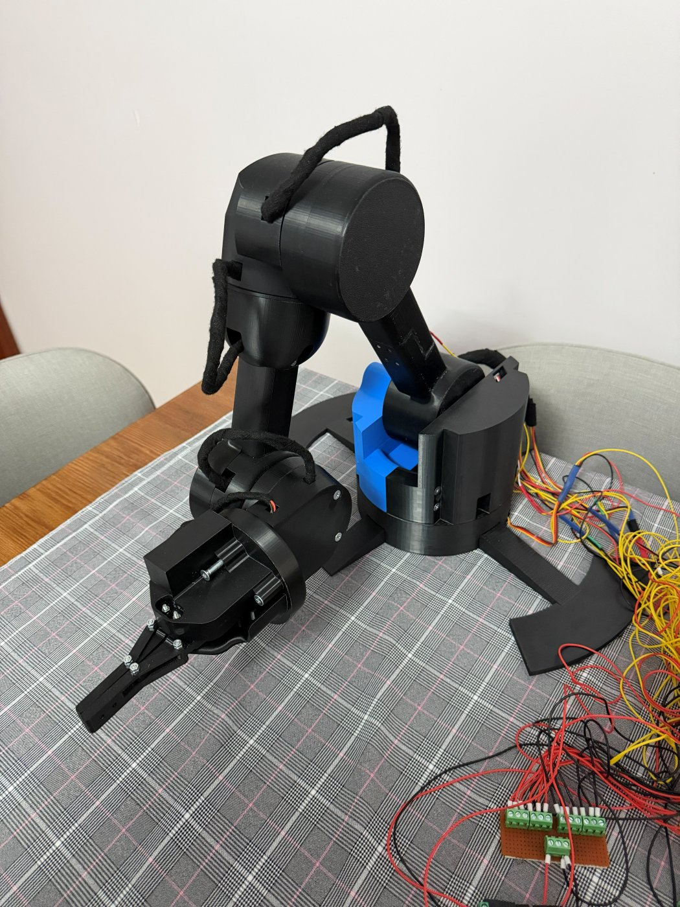 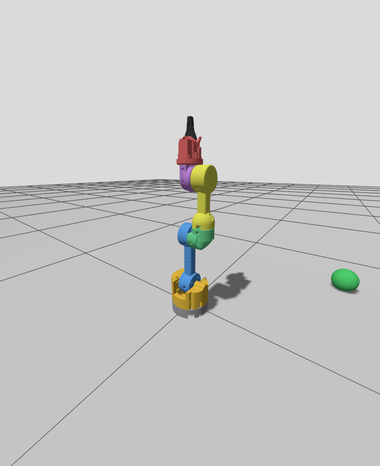

> **Şekil 1:** (a) `rk6`'nın 3B baskı parçalar ve servolarla üretilmiş gerçek hali. (b) Aynı tasarımın Gazebo Jetty'deki modeli, sıfır pozda ($\theta_i = 0$, kol dimdik yukarı). Robot doğrudan zeminde durur; mesh'ler Fusion 360 tasarımından gelir. Uçta siyah parmaklı gripper görülür. Arka plandaki küre, kutu ve silindir kameranın görebileceği hedeflerdir (kolun erişim alanının dışında).

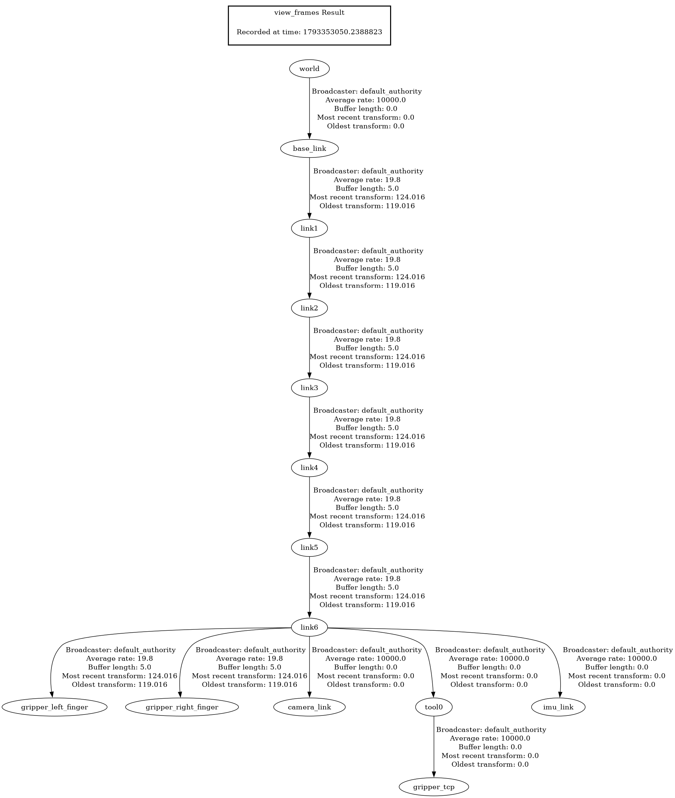

> **Şekil 2:** `ros2 run tf2_tools view_frames` ile simülasyondan üretilen TF ağacı: `world → base_link → link1 … link6`; `link6`'ya bağlı `tool0`, `camera_link`, `imu_link` ve iki parmak; `tool0`'a bağlı `gripper_tcp`.

---

## 2. Robot Geometrisi ve Sınıflandırması

### 2.1 Geometri: **R ⊢ R ∥ R** (Articulated / eklemli kol)

Seri (açık döngü) robotlar, tabandan itibaren ilk üç eklemle sınıflandırılır:

1. **Eklem 1 → Eklem 2 (link 1): ⊢ ortogonal.**
   - Eklem 1'in ekseni dikeydir: $z_0=(0,0,1)$.
   - Eklem 2'nin ekseni yataydır: $z_1=(-\sin\theta_1,\cos\theta_1,0)$.
   - DH tablosunda $\alpha_1=-90^\circ$ ve $a_1=0$ olduğundan iki eksen $O_1=(0,0,0.1313)$ noktasında **90° ile kesişir**. Bu nedenle link 1 ortogonal linktir (⊢).
2. **Eklem 2 → Eklem 3 (link 2): ∥ paralel.**
   - $\alpha_2=0$ olduğundan $z_2 \parallel z_1$, yani omuz ve dirsek eksenleri birbirine paraleldir.
   - Eksenler arasındaki uzaklık $a_2=0.22995$ m'dir.
3. **Eklem 3**, döner eklemdir (R).

Sonuç olarak `rk6` **R ⊢ R ∥ R** sınıfındadır. Bu, PUMA tipi kollarla aynı “Articulated: RRR” sınıfıdır.

Bilek eklemlerinin ilişkileri de benzer şekilde belirlendi:

- $z_2 ⊢ z_3$, $z_3 ⊢ z_4$ ve $z_4 ⊢ z_5$: $\alpha=\pm 90^\circ$ ve $a=0$ olduğu için her çift dik açıyla kesişir.

Tam zincir R ⊢ R ∥ R ⊢ R ⊢ R ⊢ R olur. Ancak $d_5=-0.066$ m kaçıklığı yüzünden eklem 4, 5 ve 6'nın eksenleri **tek bir noktada kesişmez**, yani bilek küresel (spherical) değildir. Bunun sonucu, ters kinematikte pozisyon ve yönelim problemlerinin birbirinden kolayca ayrıştırılamamasıdır (bkz. §6A).

### 2.2 Diğer ölçütler

| Ölçüt | rk6 |
|---|---|
| Serbestlik derecesi | 6 (6 aktif R eklem). Uzayda 3 pozisyon ve 3 yönelimi kontrol edebilir. İlk 3 eklem kabaca konumu, son 3 eklem yönelimi belirler. |
| Çalışma uzayı | Articulated tipi olduğu için küresel/torus benzeri bir hacimdir. Omuzdan kinematik erişim $a_2+d_4+d_6 \approx 0.661$ m'dir; mesh kutularının köşelerine göre en büyük yatay erişim J1 ekseninden 0.676 m'dir. Sıfır pozda uç nokta tabandan 0.792 m yüksektedir. Eklem limitleri (özellikle J5 ±90°) yüzünden *becerikli (dexterous)* uzay, *erişilebilir (reachable)* uzaydan belirgin şekilde küçüktür: örneğin gripper dik aşağı bakarken `tool0` en fazla ≈ 0.14 m yüksekliğe çıkabilir. |
| Aktüatör | Elektrik (gerçek kolda servo; simülasyonda ideal pozisyon kontrollü eklem). |
| Kontrol | Kapalı döngü, **noktadan noktaya (point-to-point)**. Home → K1 → K2 → K3 → Home hareketi bir trajectory kontrolcüsü ile yapılır. |
| Uygulama | Hafif al-yerleştir (pick and place) ve bilek kamerasıyla görsel denetim (inspecting). |

---

## 3. Eklem Koordinat Çerçevelerinin Yerleşimi

Çerçeveler **standart Denavit–Hartenberg** kuralına göre yerleştirildi:

- $z_{i-1}$ ekseni, $i$. eklemin dönme eksenidir.
- $x_i$ ekseni, $z_{i-1}$ ile $z_i$'nin ortak normalidir.
- DH çerçevesi $\{0\}$ = `base_link`, DH çerçevesi $\{6\}$ = `tool0`; ek bir sabit taban ya da uç dönüşümü yoktur.
- Renk kuralı RViz ile aynıdır: X kırmızı, Y yeşil, Z mavi.

$$
A_i \;=\; {}^{i-1}T_i \;=\; R_z(\theta_i+\delta_i)\;T_z(d_i)\;T_x(a_i)\;R_x(\alpha_i)
$$

Burada $\delta_i$, URDF'teki sıfır pozu (kol dimdik yukarı) DH sıfırına eşleyen sabit açı ofsetidir.

### 3.1 DH tablosu

| $i$ | $\theta_i$ (değişken) | ofset $\delta_i$ | $d_i$ [m] | $a_i$ [m] | $\alpha_i$ |
|---|---|---|---|---|---|
| 1 | $\theta_1$ | 0 | 0.1313 | 0 | $-\pi/2$ |
| 2 | $\theta_2$ | $-\pi/2$ | 0 | 0.22995 | 0 |
| 3 | $\theta_3$ | $+\pi/2$ | 0.0652 | 0 | $+\pi/2$ |
| 4 | $\theta_4$ | 0 | 0.22995 | 0 | $-\pi/2$ |
| 5 | $\theta_5$ | 0 | −0.0660 | 0 | $+\pi/2$ |
| 6 | $\theta_6$ | 0 | 0.20093 | 0 | 0 |

### 3.2 Sıfır pozda çerçeveler

Değerler $\theta=0$ için verilmiştir. Hepsi `base_link` = $\{0\}$ çerçevesine göredir ve numerik olarak hesaplanmıştır.

| Çerçeve | Orijin $O_i$ [m] | $x_i$ | $y_i$ | $z_i$ | Açıklama |
|---|---|---|---|---|---|
| $\{0\}$ | (0, 0, 0) | (1,0,0) | (0,1,0) | (0,0,1) | `base_link`: taban plakasının alt yüzü (zemin). $z_0$ eklem 1 ekseni. |
| $\{1\}$ | (0, 0, 0.1313) | (1,0,0) | (0,0,−1) | (0,1,0) | Omuz: J1 ve J2 eksenlerinin kesişimi. $z_1$ eklem 2 ekseni. |
| $\{2\}$ | (0, 0, 0.36125) | (0,0,1) | (1,0,0) | (0,1,0) | Dirsek. $x_2$ üst kol boyunca yukarıyı gösterir; $z_2$ eklem 3 ekseni. |
| $\{3\}$ | (0, 0.0652, 0.36125) | (1,0,0) | (0,1,0) | (0,0,1) | Dirsekte $+y$ yönünde yanal kaçıklık. $z_3$ ön kol (eklem 4) ekseni. |
| $\{4\}$ | (0, 0.0652, 0.5912) | (1,0,0) | (0,0,−1) | (0,1,0) | Bilek merkezi, $z_4$ eklem 5 ekseni. |
| $\{5\}$ | (0, −0.0008, 0.5912) | (1,0,0) | (0,1,0) | (0,0,1) | Bilek kaçıklığı sonrası, $z_5$ eklem 6 ekseni. |
| $\{6\}$ = `tool0` | (0, −0.0008, 0.79213) | (1,0,0) | (0,1,0) | (0,0,1) | Uç-efektör (parmak pad ortası). $z_6$ yaklaşma (approach) yönüdür. |

**TF (RViz) çerçeveleri ile DH çerçeveleri arasındaki ilişki.** URDF'te link çerçeveleri DH çerçeveleriyle aynı **değildir**: sıfır pozda bütün link çerçeveleri `base_link`'e paraleldir ve orijinleri servo horn yüzeylerindedir (mesh'lerin doğru yerleşmesi için). Buna karşılık:

- `base_link` $=\{0\}$ ve `tool0` $=\{6\}$ tam olarak çakışır; yani TF'teki `base_link → tool0` dönüşümü ${}^0T_6$'ya eşittir.
- Her `link_i`'nin dönme ekseni, DH'deki $z_{i-1}$ ile **aynı doğrudur** (yalnızca o doğru üzerindeki orijin noktası farklıdır). Örneğin `link2`'nin $y$ ekseni $z_1$ doğrusu üzerindedir ama orijini $(0,-0.0308,0.1313)$'tedir, DH $O_1$ ise $(0,0,0.1313)$'tedir.
- Bu yüzden Şekil 3'teki DH eksenleri ($x_i$, $z_i$) RViz'deki link eksenlerinden alınmadı; DH tablosundan düz kinematikle ayrıca hesaplanıp çizildi.

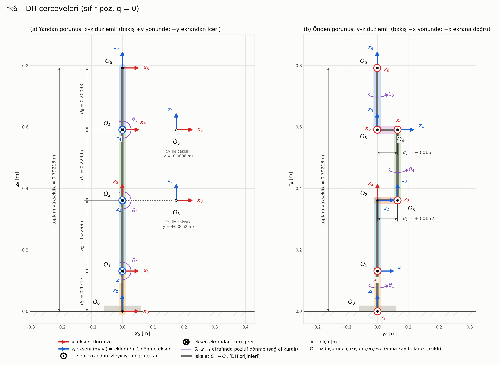

> **Şekil 3:** Sıfır pozda ($\theta_i = 0$, kol dimdik yukarı) DH çerçeveleri $O_0…O_6$: (a) yandan ($x$–$z$ düzlemi), (b) önden ($y$–$z$ düzlemi; $d_3=+0.0652$ ve $d_5=-0.066$ yanal kaçıklıkları burada görülür). Kırmızı oklar $x_i$, mavi oklar $z_i$; görüntü düzlemine dik eksenler ⊙ (ekrandan dışarı) / ⊗ (ekrandan içeri) ile, eklem açıları $\theta_1…\theta_6$ ilgili $z_{i-1}$ ekseni etrafında mor kavisli oklarla gösterilir. Ölçüler metre cinsindendir: $d_1=0.1313$, $a_2=0.22995$, $d_4=0.22995$, $d_6=0.20093$, toplam yükseklik 0.79213 m. Yandan görünüşte izdüşümü $O_2$ ve $O_4$ ile çakışan $O_3$ ve $O_5$ yana kaydırılarak çizilmiştir. Çerçeveler DH tablosundan düz kinematikle hesaplanarak çizildi ve §3.2'deki tabloyla $10^{-6}$ içinde eşleşir.

---

## 4. Düz Kinematik Denklemi: ${}^0T_n$ ($n=6$)

### 4.1 Genel form

Notasyon: $c_i=\cos\theta_i$, $s_i=\sin\theta_i$, $c_{23}=\cos(\theta_2+\theta_3)$, $s_{23}=\sin(\theta_2+\theta_3)$.

$$
A_i=\begin{bmatrix}
\cos\vartheta_i & -\sin\vartheta_i\cos\alpha_i & \sin\vartheta_i\sin\alpha_i & a_i\cos\vartheta_i\\
\sin\vartheta_i & \cos\vartheta_i\cos\alpha_i & -\cos\vartheta_i\sin\alpha_i & a_i\sin\vartheta_i\\
0 & \sin\alpha_i & \cos\alpha_i & d_i\\
0&0&0&1\end{bmatrix},\qquad \vartheta_i=\theta_i+\delta_i
$$

### 4.2 Her eklemin dönüşüm matrisi

Ofsetler yerine konmuştur. $\theta_2-\pi/2$ için $\cos=s_2$ ve $\sin=-c_2$; $\theta_3+\pi/2$ için $\cos=-s_3$ ve $\sin=c_3$ olur. Matrisler sembolik olarak (sympy) türetilip kontrol edildi.

$$
{}^0T_1=A_1=\begin{bmatrix} c_1&0&-s_1&0\\ s_1&0&c_1&0\\ 0&-1&0&0.1313\\0&0&0&1\end{bmatrix}\qquad
{}^1T_2=A_2=\begin{bmatrix} s_2&c_2&0&0.22995\,s_2\\ -c_2&s_2&0&-0.22995\,c_2\\ 0&0&1&0\\0&0&0&1\end{bmatrix}
$$

$$
{}^2T_3=A_3=\begin{bmatrix} -s_3&0&c_3&0\\ c_3&0&s_3&0\\ 0&1&0&0.0652\\0&0&0&1\end{bmatrix}\qquad
{}^3T_4=A_4=\begin{bmatrix} c_4&0&-s_4&0\\ s_4&0&c_4&0\\ 0&-1&0&0.22995\\0&0&0&1\end{bmatrix}
$$

$$
{}^4T_5=A_5=\begin{bmatrix} c_5&0&s_5&0\\ s_5&0&-c_5&0\\ 0&1&0&-0.066\\0&0&0&1\end{bmatrix}\qquad
{}^5T_6=A_6=\begin{bmatrix} c_6&-s_6&0&0\\ s_6&c_6&0&0\\ 0&0&1&0.20093\\0&0&0&1\end{bmatrix}
$$

$$
\boxed{{}^0T_6={}^0T_1\,{}^1T_2\,{}^2T_3\,{}^3T_4\,{}^4T_5\,{}^5T_6=\begin{bmatrix}{}^0R_6 & {}^0p_6\\ 0\;0\;0 & 1\end{bmatrix}},\qquad
{}^0r_P={}^0T_6\,[0\;0\;0\;1]^T
$$

### 4.3 Dinlenme dönüşümü × eklem rotasyonu

Her eklem, sabit bir **dinlenme dönüşümü** $TD_i$ (tüm açılar 0 iken bir sonraki çerçevenin yeri) ile eklemin kendi ekseni etrafındaki **rotasyonu** $R_i$ çarpılarak da yazılabilir. URDF'teki her `joint` tam olarak bu yapıdadır:

$$
{}^{\text{parent}}T_{\text{child}} \;=\; \underbrace{T(\texttt{origin xyz})}_{TD_i}\;\cdot\;\underbrace{R_{\text{axis}}(q_i)}_{R_i}
$$

Bütün `rpy` değerleri 0 olduğu için $TD_i$ yalnızca bir ötelemedir (bkz. §1.4 tablosu) ve eksenler $z$ (J1, J4, J6) ya da $y$ (J2, J3, J5)'dir. Bu yöntemle zincir:

$$
{}^{base}T_{tool0}=TD_1R_z(q_1)\;TD_2R_y(q_2)\;TD_3R_y(q_3)\;TD_4R_z(q_4)\;TD_5R_y(q_5)\;TD_6R_z(q_6)\;TD_{tool},\qquad TD_{tool}=T_z(0.15013)
$$

DH tablosu bu zincirin eşdeğeridir: aynı eksen doğruları üzerinde yalnızca orijinler kaydırılır ve çerçeveler $\delta_i$ ile döndürülür. Örneğin `joint2` ile `joint3` arasındaki $TD_3=T(0,\,0.0509,\,0.22995)$ ötelemesinin eksene dik bileşeni üst kol boyu $a_2=0.22995$'i, eksen boyunca bileşeni ise $d_3$'ün bir parçasını verir. Ofsetler, URDF sıfırı (kol yukarı) ile DH sıfırı arasındaki farktır: $\delta_2=-\pi/2$ ($x_1$ yatay iken $x_2$ dikey), $\delta_3=+\pi/2$.

**Numerik doğrulama:** xacro'dan üretilen URDF zinciri 200 rastgele $q$ için hesaplanıp DH ${}^0T_6$ ile karşılaştırıldı: en büyük eleman farkı $5.6\times10^{-16}$ (makine hassasiyeti). Yani TF'teki `base_link → tool0` hem konum hem yönelim olarak ${}^0T_6$'ya eşittir; `/ee_pose` ile FK arasındaki fark yalnızca yayın/örnekleme kaynaklıdır.

### 4.4 Açık (kapalı form) uç-efektör konumu

Önce ${}^0R_3$ hesaplanır. Sütunları sırasıyla $x_3$, $y_3$ ve $z_3$'tür:

$$
{}^0R_3=\begin{bmatrix} c_1 c_{23} & -s_1 & c_1 s_{23}\\ s_1 c_{23} & c_1 & s_1 s_{23}\\ -s_{23} & 0 & c_{23}\end{bmatrix}
$$

Bilek kısmının dönüşümü:

$$
{}^3R_6=\begin{bmatrix}
c_4c_5c_6-s_4s_6 & -c_4c_5s_6-s_4c_6 & c_4s_5\\
s_4c_5c_6+c_4s_6 & -s_4c_5s_6+c_4c_6 & s_4s_5\\
-s_5c_6 & s_5s_6 & c_5
\end{bmatrix},\qquad
{}^3p_6=\begin{bmatrix} 0.20093\,c_4s_5+0.066\,s_4\\ -0.066\,c_4+0.20093\,s_4s_5\\ 0.22995+0.20093\,c_5\end{bmatrix}
$$

Uç nokta ${}^0p_6 = {}^0T_3\,[{}^3p_6;1]$ ifadesinden türetildi. Üç yardımcı büyüklük tanımlanır:

$$
\alpha(\theta_4,\theta_5)=0.20093\,c_4 s_5+0.066\,s_4,\qquad \gamma(\theta_5)=0.22995+0.20093\,c_5,\qquad h(\theta_4,\theta_5)=0.0652-0.066\,c_4+0.20093\,s_4 s_5
$$

$$
r = 0.22995\,s_2+\gamma\,s_{23}+\alpha\,c_{23}
$$

$$
\boxed{\begin{aligned}
p_x &= c_1\,r - s_1\,h\\
p_y &= s_1\,r + c_1\,h\\
p_z &= 0.1313 + 0.22995\,c_2 + \gamma\,c_{23} - \alpha\,s_{23}
\end{aligned}}
$$

Burada $r$, J1 düzlemindeki yatay erişim; $h$ ise bu düzleme dik yanal kaçıklıktır. Yönelim ${}^0R_6={}^0R_3\,{}^3R_6$'dır. Yaklaşma yönü ($z_6$, 3. sütun):

$$
z_6=\begin{bmatrix} c_1(c_4 s_5 c_{23}+c_5 s_{23}) - s_1 s_4 s_5\\ s_1(c_4 s_5 c_{23}+c_5 s_{23}) + c_1 s_4 s_5\\ c_5 c_{23} - c_4 s_5 s_{23}\end{bmatrix}
$$

### 4.5 Sıfır poz kontrolü

$\theta_1=\dots=\theta_6=0$ için:

$$
{}^0T_6\big|_{\theta=0}=\begin{bmatrix}1&0&0&0\\0&1&0&-0.0008\\0&0&1&0.79213\\0&0&0&1\end{bmatrix}
$$

Geometrik yorumu şöyledir:

- **Dikey:** $d_1+a_2+d_4+d_6=0.1313+0.22995+0.22995+0.20093=0.79213$ m; kol dimdik yukarıdadır.
- **Yatay:** $r=0$ (bütün linkler dikey).
- **Yanal:** kaçıklıklar neredeyse birbirini götürür: $h = d_3 + d_5 = 0.0652-0.066=-0.0008$ m.
- **Yönelim:** ${}^0R_6=I$; takım ekseni $z_6$ yukarıyı ($+z_0$) gösterir ve parmaklar $y_0$ boyunca açılır.

Bu değer, Gazebo'da T1 konfigürasyonunda ölçülen `tool0` konumuyla (0.000000, −0.000800, 0.792130) m aynıdır (§5.2).

---

## 5. Hata Analizi: 10 Konfigürasyonda FK ve Gazebo Konumları

### 5.1 Yöntem

Her test konfigürasyonu için aşağıdaki adımlar uygulanır:

1. `fk_error_analysis` node'u, hedef $q$'yu `/arm_controller/follow_joint_trajectory` action'ı ile gönderir (4 s).
2. Robot hedefe oturana kadar beklenir: $\max_i |q_{ölç,i}-q_{hedef,i}| < 0.005$ rad (parametre `settle_tol_rad`, zaman aşımı 20 s), ardından ek olarak 1 s (`extra_wait_s`).
3. 20 örnek boyunca (`samples`) aynı anda üç değer kaydedilir ve ortalaması alınır:
   - **(a)** `/joint_states`'ten ölçülen $q_{ölç}$.
   - **(b)** `/ee_pose` (TF `base_link→tool0`).
   - **(c)** Gazebo PosePublisher'ın ölçtüğü link pozları: `/rk6/pose` (`gz.msgs.Pose_V`) → ros_gz_bridge → `/gz_link_poses` (`tf2_msgs/msg/TFMessage`). Bu mesajdan `tool0` ve `base_link` pozları alınır.
4. DH modeliyle $p_{FK}=\text{FK}(q)$ hesaplanır.
5. Öklid hatası hesaplanır: $e_k=\lVert p_{FK}-p_{Gazebo}\rVert_2$.
6. $N$ konfigürasyon üzerinden ortalama ve standart sapma alınır:

$$
\bar e=\frac1N\sum_{k=1}^{N}e_k,\qquad \sigma_e=\sqrt{\frac{1}{N-1}\sum_{k=1}^{N}(e_k-\bar e)^2}
$$

**Not 1 (Gazebo pozunun `base_link`'e taşınması):** PosePublisher pozları model çerçevesine göre yayınlar. Robot zeminde durduğu için `base_link` model orijinindedir, ama kod bunu varsaymaz; her mesajda genel dönüşümü uygular:

$$
{}^{base}T_{tool0} = \big({}^{model}T_{base\_link}\big)^{-1}\;{}^{model}T_{tool0},\qquad
p_{Gazebo} = R_b^{T}\,(p_{tool0}-p_{b})
$$

`tool0` sabit eklemi `rk6.gazebo.xacro`'da `preserveFixedJoint` ile korunduğu için Gazebo'da ayrı bir link olarak kalır ve pozu doğrudan yayınlanır.

**Not 2 (iki hata kaynağı):** `fk_error_analysis` iki Gazebo hatasını ayrı ayrı hesaplar ve CSV/MD dosyasına yazar:

- $e_k=\lVert \text{FK}(q_{komut})-p_{Gazebo}\rVert$ (sütun `e_gz_m`). Bu, eklem takip hatasını da içerir. Raporda ana hata olarak bu kullanılır.
- $e_k^{ölç}=\lVert \text{FK}(q_{ölç})-p_{Gazebo}\rVert$ (sütun `e_gz_meas_m`). Bu, takip hatasından arındırılmış model/simülasyon uyumsuzluğunu gösterir.

Ayrıca $\lVert \text{FK}(q_{komut})-p_{/ee\_pose}\rVert$ (sütun `e_ros_m`) da verilir.

### 5.2 Test konfigürasyonları ve FK sonuçları (T1–T10)

Konfigürasyonlar eklem limitlerinin içinde, hiçbir link kutusu zemine ya da tabana girmeyecek ve `tool0` zeminden en az 0.2 m yukarıda kalacak şekilde seçildi. FK değerleri DH modeliyle (`rk6_control/kinematics.py`), Gazebo değerleri `fk_error_analysis` ile simülasyonda ölçüldü (ham veri: `rapor/sonuclar/fk_error_20261030_123836.csv`). Konumlar metre, hata **mikrometre** (1 µm = 0.001 mm) cinsindendir.

| # | $q$ [derece] ($\theta_1…\theta_6$) | $q$ [rad] | $x_{FK}$ | $y_{FK}$ | $z_{FK}$ | $x_{Gz}$ | $y_{Gz}$ | $z_{Gz}$ | $e$ [µm] |
|---|---|---|---|---|---|---|---|---|---|
| T1 | 0, 0, 0, 0, 0, 0 | 0, 0, 0, 0, 0, 0 | 0.000000 | −0.000800 | 0.792130 | 0.000000 | −0.000800 | 0.792130 | 0.256 |
| T2 | 45, 20, 0, 0, 0, 0 | 0.7854, 0.3491, 0, 0, 0, 0 | 0.160384 | 0.159253 | 0.752277 | 0.160384 | 0.159252 | 0.752277 | 0.310 |
| T3 | 0, 30, 0, 0, 0, 0 | 0, 0.5236, 0, 0, 0, 0 | 0.330415 | −0.000800 | 0.703596 | 0.330415 | −0.000800 | 0.703596 | 0.071 |
| T4 | 0, 0, 60, 0, 0, 0 | 0, 0, 1.0472, 0, 0, 0 | 0.373153 | −0.000800 | 0.576690 | 0.373153 | −0.000800 | 0.576690 | 0.317 |
| T5 | 0, 0, 0, 0, 60, 0 | 0, 0, 0, 0, 1.0472, 0 | 0.174010 | −0.000800 | 0.691665 | 0.174011 | −0.000800 | 0.691665 | 0.231 |
| T6 | −45, 20, 45, 0, −30, 0 | −0.7854, 0.3491, 0.7854, 0, −0.5236, 0 | 0.283905 | −0.285036 | 0.609156 | 0.283905 | −0.285036 | 0.609156 | 0.361 |
| T7 | 60, −20, 70, 45, 30, 80 | 1.0472, −0.3491, 1.2217, 0.7854, 0.5236, 1.3963 | 0.075663 | 0.310192 | 0.516873 | 0.075663 | 0.310192 | 0.516873 | 0.057 |
| T8 | −30, 45, 45, −60, 60, −45 | −0.5236, 0.7854, 0.7854, −1.0472, 1.0472, −0.7854 | 0.367714 | −0.349129 | 0.264052 | 0.367714 | −0.349129 | 0.264052 | 0.243 |
| T9 | 85, 10, 80, 30, −45, 30 | 1.4835, 0.1745, 1.3963, 0.5236, −0.7854, 0.5236 | 0.098662 | 0.404901 | 0.447801 | 0.098662 | 0.404901 | 0.447801 | 0.109 |
| T10 | −75, −30, 100, −85, 85, 60 | −1.3090, −0.5236, 1.7453, −1.4835, 1.4835, 1.0472 | −0.109035 | −0.133823 | 0.460470 | −0.109035 | −0.133823 | 0.460470 | 0.493 |
| | | | | | | | | **Ortalama $\bar e$** | **0.245 µm** |
| | | | | | | | | **Std. sapma $\sigma_e$ (n−1)** | **0.137 µm** |

Yani $\bar e = 0.000245$ mm ve $\sigma_e = 0.000137$ mm'dir. En büyük hata 0.493 µm (T10), en küçüğü 0.057 µm (T7). Tablodaki Gazebo konumları 6 basamağa yuvarlandığı için çoğu satırda FK ile aynı görünür; hata, yuvarlanmamış değerlerden hesaplanmıştır.

Diğer iki karşılaştırma (aynı ölçümden):

| Karşılaştırma | Ortalama | Std. sapma (n−1) | En büyük | Anlamı |
|---|---|---|---|---|
| $\lVert \text{FK}(q_{komut}) - p_{Gazebo}\rVert$ | 0.245 µm | 0.137 µm | 0.493 µm | Ana sonuç (yukarıdaki tablo) |
| $\lVert \text{FK}(q_{ölç}) - p_{Gazebo}\rVert$ | 0.242 µm | 0.137 µm | 0.490 µm | Eklem takip hatası çıkarılmış |
| $\lVert \text{FK}(q_{komut}) - p_{/ee\_pose}\rVert$ | 0.003 µm | 0.002 µm | 0.006 µm | ROS TF ile DH modeli |

Konfigürasyonların seçim mantığı:

- T1–T5 tek tek (ya da ikili) eklem etkisini gösterir: T1 sıfır poz, T3 yalnızca omuz, T4 yalnızca dirsek, T5 yalnızca bilek eğme ($\delta_2$, $\delta_3$ ofsetlerini ve eksen işaretlerini ayrı ayrı sınar). T2'de bel döndüğünde $p_x \approx p_y$ olur (45°).
- T6–T10 birleşik duruşlardır; bilek eklemleri (J4, J6) dahil hepsi değişir. T10 eklem limitlerine yakındır (J4 −85°, J5 +85°).

**Yorum.** Hatalar mikrometre altındadır; bu, Fusion'dan türetilen DH modelinin, URDF'in ve Gazebo'daki robotun aynı geometriye sahip olduğunu gösterir. Ofset ya da uzunluk hatası olsaydı hata milimetre-santimetre düzeyinde ve sistematik olurdu. T3, T4, T5 gibi tek eklemli testlerde büyük bir hata görülmemesi, $\delta_2=-\pi/2$ ve $\delta_3=+\pi/2$ ofsetlerinin ve eksen işaretlerinin doğru eşlendiğini doğrular. $q_{komut}$ ile $q_{ölç}$ arasındaki fark sonucu yalnızca ~0.003 µm değiştirir; yani kalan hata eklem takibinden gelmez; en olası kaynak fizik motorunun sayısal çözümüdür (eklem kısıtlarının çok küçük esnemesi, 1 ms zaman adımı). ROS TF ile DH arasındaki fark ise yalnızca kayan nokta yuvarlamasıdır (~0.003 µm), çünkü TF de aynı URDF zincirinden hesaplanır.

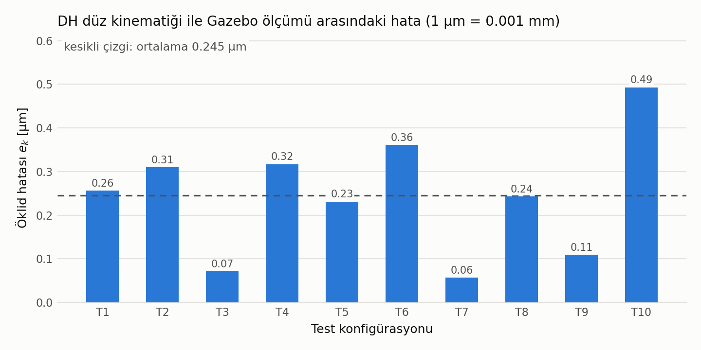

> **Şekil 4:** Konfigürasyon başına DH–Gazebo Öklid hatası (µm) ve ortalama çizgisi (veri: `rapor/sonuclar/fk_error_20261030_123836.csv`).

### 5.3 Hata kaynakları

FK hesabı ve Gazebo aynı URDF/DH geometrisini kullandığı için hata µm mertebesinde kalır; kalan fark kayan nokta yuvarlamasından ve fizik motorunun sayısal çözümünden (1 ms simülasyon adımı) gelir. Gerçek kolda ise ana hata kaynakları montaj ve 3B baskı toleransları, servo dişli boşluğu ve eklem sıfırlarının kalibrasyonu olacaktır.

---

## 6. Hareket Görevi ve Görselleştirme: Home → K1 → K2 → K3 → Home

| # | $q$ [derece] | $q$ [rad] | $p_{FK}$ [m] |
|---|---|---|---|
| Home | 0, 0, 0, 0, 0, 0 | 0, 0, 0, 0, 0, 0 | (0.0000, −0.0008, 0.7921) |
| K1 | 45, 30, 60, 0, 60, 0 | 0.7854, 0.5236, 1.0472, 0, 1.0472, 0 | (0.3155, 0.3144, 0.1564) |
| K2 | −60, 20, 70, 45, 45, 60 | −1.0472, 0.3491, 1.2217, 0.7854, 0.7854, 1.0472 | (0.3284, −0.3308, 0.2002) |
| K3 | 0, −20, 100, 0, 70, 0 | 0, −0.3491, 1.7453, 0, 1.2217, 0 | (0.2483, −0.0008, 0.2133) |

K1–K3'te gripper aşağı/öne bakar (ör. K1 ve K3'te $z_6$'nın düşey bileşeni −0.866). K2'de Gazebo'da `/ee_pose`'tan okunan konum (0.3284, −0.3308, 0.2002) m'dir, yani FK ile aynıdır.

Görev iki node ile yapılır:

- **`motion_sequence`** (rclpy) her hedefi ayrı bir `FollowJointTrajectory` action goal'u olarak sırayla gönderir ve bir sonraki hedefe geçmeden önce result'u bekler. Segment süreleri varsayılan olarak Home 3 s, K1/K2/K3/Home 4'er s'dir (parametre `durations`); her hedefe varınca 1 s beklenir (`pause_s`). Her hedefe varıldıktan sonra gripper sırayla açılır/kapanır (Home: açık 0.0235 m, K1: kapalı, K2: açık, K3: kapalı, Home: açık; parametre `gripper_sequence`, metre). Bu, *action* yapısına (goal, feedback, result, iptal edilebilir) ve kapalı döngü *point-to-point* kontrole uyar. Simülasyondaki çalıştırmada beş hedefin ve beş gripper komutunun hepsi `OK` sonucuyla tamamlandı.
- **`visualizer`** şu topic'lere abone olur:
  - `/joint_states`: eklem açılarını zamana göre matplotlib ile canlı çizer (son 20 s).
  - `/wrist_camera/image_raw`: görüntüyü cv_bridge ve OpenCV penceresinde gösterir.
  - `/ee_pose`: uç-efektör konumunu grafiğin altına metin olarak yazar.
- IMU verisi (`/imu`) `visualizer`'da çizilmez; demoda `ros2 topic echo /imu` ya da `rqt_plot` ile gösterilir. Örnek: kol Şekil 7'deki duruştayken ($q = (20, 30, 60, 0, 25, 0)^\circ$) `linear_acceleration` = (−8.89, 0.00, −4.15) m/s² okundu; büyüklüğü ≈ 9.81 m/s² olup yerçekiminin IMU eksenlerine (link6) izdüşümüdür.

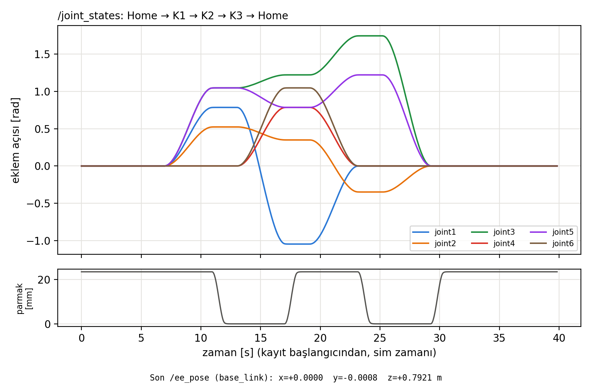

> **Şekil 5:** Simülasyonda Home → K1 → K2 → K3 → Home hareketi sırasında `/joint_states`'ten kaydedilen eklem açıları (üstte) ve gripper parmak konumu (altta, mm). Kol başlangıçta zaten Home'da olduğundan ilk segment düzdür; ~7–11 s K1, ~13–17 s K2, ~19–23.5 s K3, ~25–29.5 s Home'a dönüş. Her geçiş yumuşak bir yörüngedir ve hedefte düz bir basamak oluşur; gripper her hedefte sırayla kapanır/açılır (23.5 mm ↔ 0). Altta, hareket bitince `/ee_pose`'tan okunan uç efektör konumu (0.0000, −0.0008, 0.7921) m (veri: `rapor/sonuclar/demo_joints.csv`, `rapor/sonuclar/demo_ee.csv`).

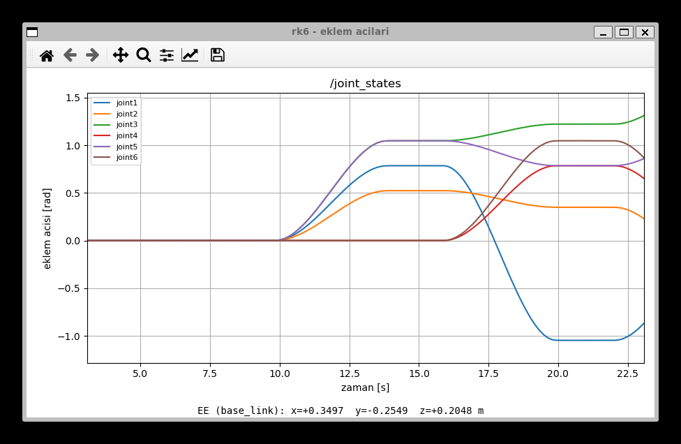

> **Şekil 6:** Aynı görev sırasında `visualizer` node'unun canlı “rk6 - eklem acilari” penceresi (K2 → K3 geçişi sırasında alınmış; altta `/ee_pose` metni).

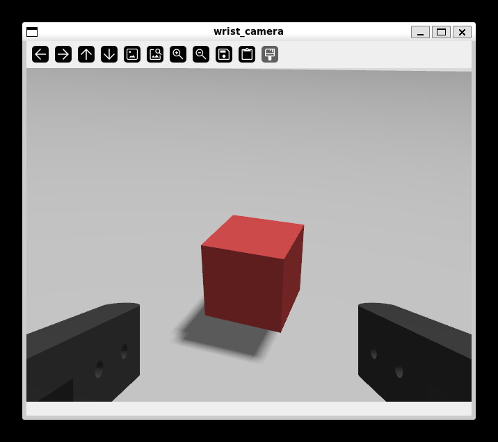

> **Şekil 7:** `visualizer`'ın `/wrist_camera/image_raw` topic'inden gösterdiği bilek kamerası görüntüsü. Kol, kamera dünyadaki kırmızı kutuya bakacak şekilde $q = (20, 30, 60, 0, 25, 0)^\circ$ duruşuna götürüldü (`/ee_pose` = (0.4955, 0.1795, 0.2455) m). Görüntünün altındaki siyah parçalar gripper parmaklarıdır; kamera parmakların arasından yaklaşma yönüne bakar.

---

## 6A. Ek Senaryo: Ters Kinematik, Kamera ile Algılama ve Üst Üste Dizme

Bu bölüm vize isterlerinin dışındaki ek çalışmadır ve ayrı bir senaryo olarak tasarlandı. Kodu ayrı bir pakette (`rk6_manipulation`), kendi dünya dosyasıyla (`worlds/rk6_pick_world.sdf`, zeminde üç adet 3 cm'lik küp) çalışır. Vize senaryosu (`rk6_description` + `rk6_control`, küpsüz dünya, §1–§6) bu pakete bağlı değildir ve tek başına çalıştırılabilir; ek senaryo `ros2 launch rk6_manipulation stack_demo.launch.py` ile başlatılır.

### 6A.1 Ters kinematik yöntemi

Düz kinematik eklem açılarından uç noktayı verir: $q \rightarrow {}^0T_{tcp}$. Ters kinematik bunun tersidir: istenen uç nokta pozu ${}^0T_d$ için gereken $q$ bulunur.

`rk6`'nın bileği küresel değildir ($d_5 = -0.066$ m kaçıklık; üç bilek ekseni tek noktada kesişmez). Bu nedenle bilek ayrıştırmasına dayanan kapalı formlu analitik çözüm pratik değildir. Bunun yerine **Jacobian tabanlı sayısal çözüm (sönümlü en küçük kareler, Levenberg–Marquardt)** kullanıldı (`rk6_manipulation/ik.py`). `tool0` zaten parmak pad'lerinin ortası olduğu için kavrama noktası ${}^0T_{tcp} = {}^0T_6$'dır.

**Hata vektörü** (konum + yönelim; yönelim hatası $R_d R^T$'nin eksen-açı gösterimi):
$$e = \begin{bmatrix} p_d - p \\ \varphi\,\hat k \end{bmatrix} \in \mathbb{R}^6,\qquad R_d R^T = \mathrm{Rot}(\hat k, \varphi)$$

**Geometrik Jacobian** DH çerçevelerinden kurulur; her eklem $z_{i-1}$ ekseni etrafında döner:
$$J_i = \begin{bmatrix} z_{i-1} \times (o_n - o_{i-1}) \\ z_{i-1} \end{bmatrix}, \quad i = 1..6$$
Burada $z_{i-1}$ ve $o_{i-1}$, ${}^0T_{i-1}$ matrisinin 3. sütunu ve konum sütunudur; yani düz kinematik sırasında zaten hesaplanırlar.

**Güncelleme adımı:**
$$\Delta q = J^T (J J^T + \lambda^2 I)^{-1} e, \qquad q \leftarrow \mathrm{clip}(q + \Delta q)$$
Sönüm katsayısı tekil (singüler) duruşlarda adımın patlamasını önler. Her adımdan sonra $q$ eklem sınırlarının 0.03 rad içine kırpılır; böylece sınıra yapışık çözümler ros2_control'ün limit korumasına takılmaz.

**Çözüm seçimi:** Bir poz için birden fazla çözüm olabilir (dirsek yukarı/aşağı, bilek çevrik). Çözücü mevcut duruştan ve erişim haritasından seçilmiş birkaç başlangıç duruşundan (hepsi “dirsek öne bükülü” aileden: $q_3 > 0$) ayrı ayrı başlar; yakınsayanlar arasından mevcut duruşa en yakın olanı seçer. İki parmaklı gripper 180°, küp 90° simetrik olduğundan bu simetriler de denenir.

**Erişim:** J5 limiti (±90°) yüzünden gripper dik aşağı bakarken `tool0` en fazla ≈ 0.14 m yüksekliğe çıkabilir. Zemindeki 3 cm'lik küp için kavrama (`tool0` z = 0.017 m) tabandan $r \approx 0.175…0.425$ m'de mümkündür.

**Doğrulama:** Bu çalışmadaki Gazebo koşusunda IK ile çözülen 30 tarama durağının ve bütün al-bırak pozlarının konum hatası (`e_IK`, IK çözümünün FK'si ile hedef arasındaki fark) en fazla 0.10 mm çıktı.

### 6A.2 Kamera ile küp algılama ve üst üste dizme

`scan_and_stack` node'unda küp konumları robota verilmez; bilek kamerasıyla bulunur.

1. **Tarama (iki halka, 30 durak).** Gripper aşağı bakarken `tool0`, 0.14 m yarıçaplı yayda −125°…+125° arasında 15 açıya götürülür. 1. halkada yükseklik 0.125 m ve dikeyden eğim 10° (yakın bant, $r \approx$ 0.16–0.25 m), 2. halkada 0.18 m ve 30° (uzak bant, $r \approx$ 0.22–0.43 m). Görüntünün alt ~1/3'ünü kapalı parmaklar kapattığı için iki halka gerekli oldu; çalışma alanının her noktası en az 2 görüntüde görünür.
2. **Renk algılama.** Her görüntüde HSV renk eşiklemesiyle kırmızı, yeşil ve mavi bloblar bulunur (OpenCV). Her blobun en küçük alanlı dikdörtgeni alınır. Görüntü kenarına ya da parmak gölgesine değen (kesik) bloblar atlanır.
3. **Pikselden konuma.** Kameranın pozu düz kinematikten hesaplanır: ${}^0T_{cam} = {}^0T_6 \cdot T_z(-0.15013) \cdot T_{6,cam}$. Burada $T_{6,cam}$, URDF'teki `camera_joint`'tir. Pikselden çıkan ışın
$$d_{cam} = \begin{bmatrix} 1 \\ -(u - c_x)/f_x \\ -(v - c_y)/f_y \end{bmatrix}, \qquad p = o + s\,R\,d_{cam}$$
küp merkezi düzlemiyle kesiştirilir. $f_x = f_y = 320/\tan(30°) \approx 554$ piksel, $(c_x, c_y) = (320, 240)$'tır. Dikdörtgenin köşeleri üst yüz düzlemine izdüşürülerek küpün yaw açısı bulunur. Küp 90° simetrik olduğundan açı $[-45°, 45°)$ aralığına indirgenir.
4. **Birleştirme.** Aynı küp birden fazla görüntüde görünebilir; aynı renkte ve yakın tespitler tek küpe sayılır.
5. **Dizme.** Küpler sırayla (kırmızı, yeşil, mavi) alınır ve robotun önündeki (0.25, 0.00) noktasına, her biri bir öncekinin 3 cm üstüne bırakılır. Küpün üstüne gelince kamera dik aşağı bakarken küp **yeniden görüntülenir** ve konum/yaw düzeltilir. Küp parmaklar arasında tam ortalanmamışsa kayma parmak konumlarından ölçülür ($\delta = (g_{sol} - g_{sağ})/2$) ve bırakma noktası buna göre düzeltilir.

Çalışma sırasında "rk6 bilek kamerasi" penceresinde canlı görüntü ve o anki adım gösterilir. İşaretli tarama görüntüleri ayrıca kaydedilir.

**Gazebo sonucu (bu çalışmada tek koşu, `stack_demo.launch.py`, dünya dosyasındaki varsayılan küp yerleşimi):**

| Küp | Gerçek konum (dünya dosyası) [m], yaw | Taramada bulunan [m], yaw (görüntü sayısı) | Fark | Üstüne gelince düzeltilmiş [m], yaw | Fark |
|---|---|---|---|---|---|
| Kırmızı | (0.170, 0.270), 20.1° | (0.170, 0.272), 32.7° (3) | 2.0 mm, 12.6° | (0.169, 0.269), 20.1° | 1.4 mm, 0.0° |
| Mavi | (0.310, −0.150), −35.0° | (0.311, −0.149), −30.1° (2) | 1.4 mm, 4.9° | (0.309, −0.149), −35.0° | 1.4 mm, 0.0° |
| Yeşil | (−0.060, −0.290), 9.7° | (−0.061, −0.291), 11.4° (4) | 1.4 mm, 1.7° | (−0.060, −0.288), 9.7° | 2.0 mm, 0.0° |

(Algılanan değerler node günlüğünde mm çözünürlükle yazıldığı için farklar ±0.7 mm belirsizdir.)

Üç küp de alınıp üst üste dizildi. Kavrama sırasında parmaklar (sol/sağ) 0.0151/0.0149, 0.0117/0.0183 ve 0.0131/0.0169 m'de durdu (küp parmakları durdurduğu için kapalı komut 0.006'ya inemedi → nesne tutuluyor); ölçülen kaymalar −2.0, −3.6, −2.5 mm idi ve bırakma noktası buna göre düzeltildi. Kulenin Gazebo'da ölçülen son hali (hedef: (0.250, 0.000) ve z = 0.015 / 0.045 / 0.075 m):

| Kat | Küp | Ölçülen son konum [m] | Hedeften yatay sapma |
|---|---|---|---|
| 1 | Kırmızı | (0.2514, 0.0006, 0.0150) | 1.6 mm |
| 2 | Yeşil | (0.2518, 0.0039, 0.0450) | 4.3 mm |
| 3 | Mavi | (0.2517, 0.0012, 0.0750) | 2.1 mm |

Katlar 3 cm aralıklı ve hedefin 5 mm içinde. Tarama 30 durakta 77.7 s, görevin tamamı (taramadan son home'a) 182.9 s sürdü (node günlüğündeki zaman damgalarına göre; gerçek zaman faktörü ≈ %100). Günlükte "out of limits" ve "tolerances failed" uyarısı yoktu. Ham günlük: `rapor/sonuclar/sekil8_kamera_dizme/scan_and_stack_log.txt`.

Algılama hatasının başlıca kaynağı perspektiftir: kamera tam tepeden bakmadığında küpün yan yüzü de görünür; blob merkezi biraz kayar ve özellikle yaw açısı bozulur (kırmızıda 12.6°). Bu yüzden küpün üstünde dik aşağı bakarak yapılan ikinci ölçüm, yaw'ı 0.1°'nin altına indirdi.

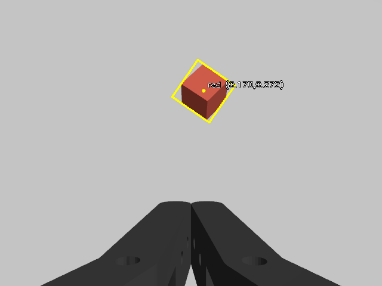 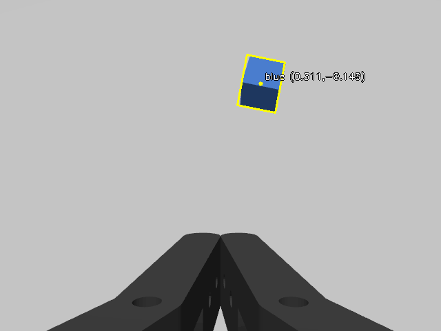 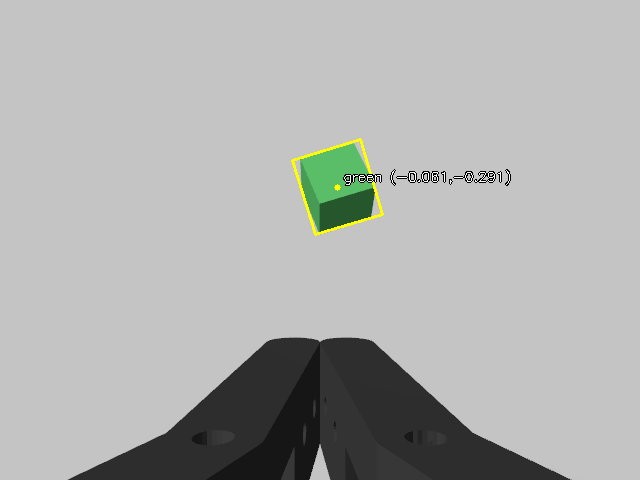

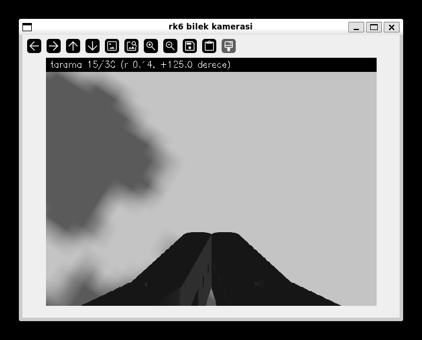 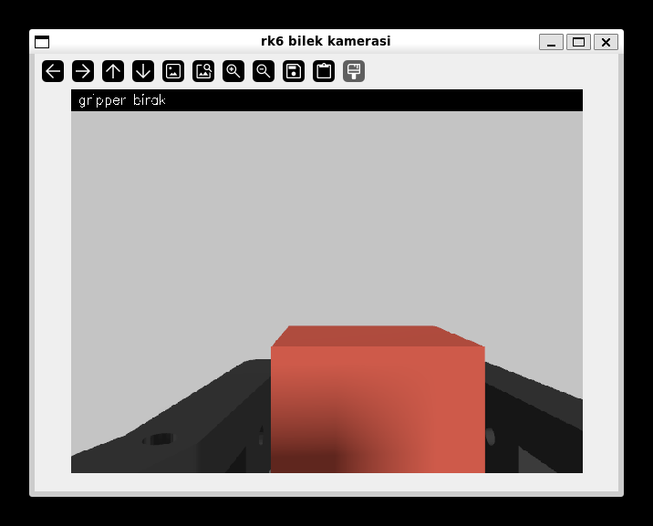

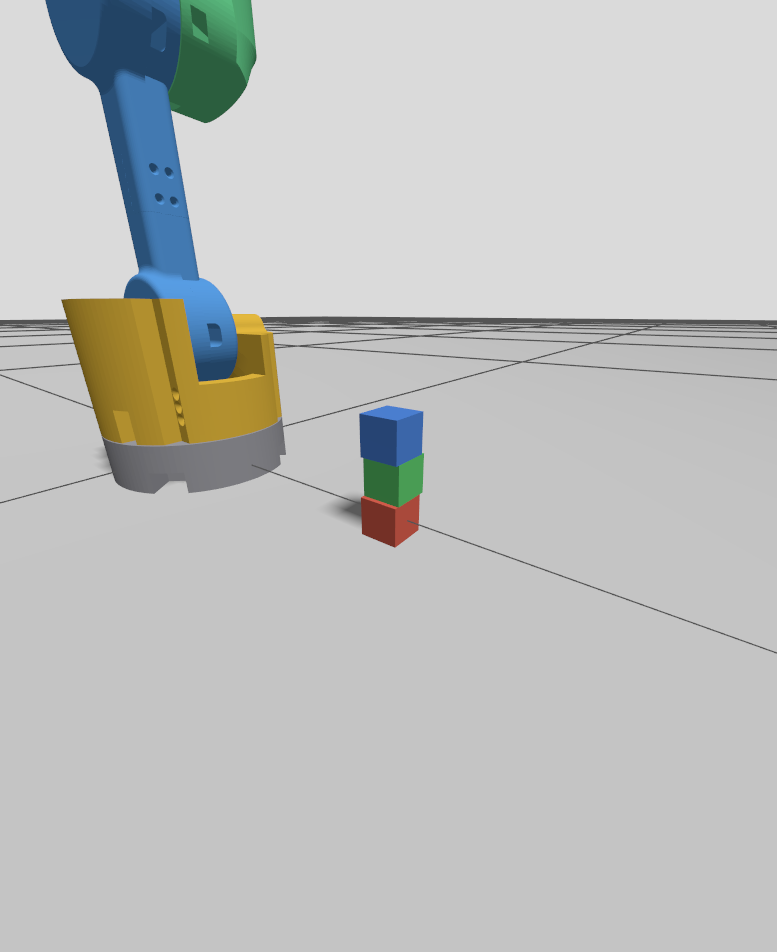

> **Şekil 8:** (a–c) 2. halka taramasında işaretlenmiş kamera görüntüleri (durak 20, 24, 28): sarı çerçeve algılanan küp, nokta merkezi, yazı hesaplanan konum; alttaki siyah parçalar kapalı parmaklardır. (d, e) Çalışma sırasında açılan "rk6 bilek kamerasi" penceresi; üstte o anki adım (tarama 15/30 ve kırmızı küpün kuleye bırakılması). (f) Gazebo'da tamamlanmış üç katlı kule.

---

## 7. ROS 2 Paketlerinin Açıklaması

Çalışma alanı `ros2_ws/src` içinde üç paketten oluşur: vize senaryosu için `rk6_description` ve `rk6_control`, ek senaryo için `rk6_manipulation`.

### 7.1 `rk6_description` (ament_cmake)

| Dosya | Görev |
|---|---|
| `urdf/rk6.urdf.xacro` (+ include'lar) | Linkler, eklemler, `ros2_control` bloğu, `gz_ros2_control` plugin'i, kamera ve IMU sensörleri, PosePublisher |
| `meshes/*.stl` | Her link için Fusion 360'tan üretilmiş tek bir STL (link çerçevesinde) |
| `urdf/rk6_mesh_props.xacro` | Otomatik üretilen kütle, ağırlık merkezi, atalet ve çarpışma kutuları |
| `urdf/rk6_gripper.xacro` | İki parmaklı paralel gripper (`gripper:=false` ile kapatılabilir) |
| `config/rk6_controllers.yaml` | `controller_manager`, `joint_state_broadcaster`, `arm_controller` ve `gripper_controller` (JointTrajectoryController, position) |
| `config/gz_bridge.yaml` | `ros_gz_bridge` eşlemeleri: `/clock`, kamera, IMU, Gazebo pozu |
| `launch/gazebo.launch.py` | Gazebo Jetty, `robot_state_publisher`, `ros_gz_sim create` (spawn), controller spawner'ları ve köprü |
| `launch/display.launch.py` | Yalnızca RViz ve `joint_state_publisher_gui` (model kontrolü için) |
| `rviz/`, `worlds/` | RViz ayarı; Sensors ve Imu sistemlerini içeren dünya dosyası |

### 7.2 `rk6_control` (ament_python)

| Node / modül | Görev |
|---|---|
| `kinematics.py` | DH tablosu, `fk(q)`, eklem limitleri ve test konfigürasyonları (T1–T10, K1–K3); DH tablosu depo kökündeki bağımsız `rk6_fk.py` ile aynıdır |
| `ee_pose_publisher` | TF `base_link→tool0` dönüşümünü okur, `/ee_pose` (PoseStamped) olarak yayınlar |
| `motion_sequence` | Home → K1 → K2 → K3 → Home hareketini action client ile yapar |
| `visualizer` | `/joint_states` grafiğini ve kamera penceresini gösterir |
| `fk_error_analysis` | T1–T10'u sırayla uygular, FK ile Gazebo pozunu karşılaştırır, CSV ve ortalama/std üretir |
| `launch/demo.launch.py`, `launch/fk_analysis.launch.py` | Hareket demosu (ee_pose_publisher + visualizer + motion_sequence) ve hata analizi |

### 7.2b `rk6_manipulation` (ament_python, ek senaryo)

| Node / modül | Görev |
|---|---|
| `ik.py` | Sayısal ters kinematik (Jacobian, sönümlü en küçük kareler) |
| `perception.py` | Renk algılama, piksel → düzlem izdüşümü, küp yaw açısı |
| `manipulator.py` | Ortak hareket yardımcıları (gripper, IK ile git, Kartezyen düz çizgi) ve canlı kamera penceresi |
| `ik_goto` | Gripper'ı verilen (x, y, z) noktasına IK ile götürür |
| `pick_place` | Konumu bilinen küpleri alıp başka noktaya bırakır |
| `scan_and_stack` | Kamerayla etrafı tarar, bulunan küpleri robotun önüne üst üste dizer |
| `launch/pick_world.launch.py`, `worlds/rk6_pick_world.sdf` | Küplü dünyayla simülasyonu başlatır |
| `launch/stack_demo.launch.py` | Tek komut: küplü simülasyon + `scan_and_stack` |

### 7.3 Topic / action tablosu

Simülasyonda `ros2 topic list -t` ve `ros2 action list -t` ile doğrulandı.

| İsim | Tip | Yayıncı → Abone |
|---|---|---|
| `/joint_states` | `sensor_msgs/msg/JointState` | joint_state_broadcaster → robot_state_publisher, visualizer, fk_error_analysis |
| `/arm_controller/joint_trajectory` | `trajectory_msgs/msg/JointTrajectory` (topic, radyan) | (CLI / kullanıcı) → arm_controller |
| `/arm_controller/follow_joint_trajectory` | `control_msgs/action/FollowJointTrajectory` (action, radyan) | motion_sequence, fk_error_analysis → arm_controller |
| `/gripper_controller/follow_joint_trajectory` | `control_msgs/action/FollowJointTrajectory` (action, metre) | motion_sequence → gripper_controller |
| `/tf`, `/tf_static` | `tf2_msgs/msg/TFMessage` | robot_state_publisher → ee_pose_publisher, RViz |
| `/ee_pose` | `geometry_msgs/msg/PoseStamped` (frame `base_link`) | ee_pose_publisher → visualizer, fk_error_analysis |
| `/gz_link_poses` | `tf2_msgs/msg/TFMessage` (Gazebo `/rk6/pose`, `gz.msgs.Pose_V`, ros_gz_bridge ile) | Gazebo PosePublisher → fk_error_analysis |
| `/wrist_camera/image_raw`, `/wrist_camera/camera_info` | `sensor_msgs/msg/Image`, `CameraInfo` | Gazebo kamera (köprü) → visualizer / rqt_image_view |
| `/imu` | `sensor_msgs/msg/Imu` | Gazebo IMU (köprü) → `ros2 topic echo` / rqt_plot |
| `/clock` | `rosgraph_msgs/msg/Clock` | Gazebo (köprü) → tüm node'lar (`use_sim_time`) |

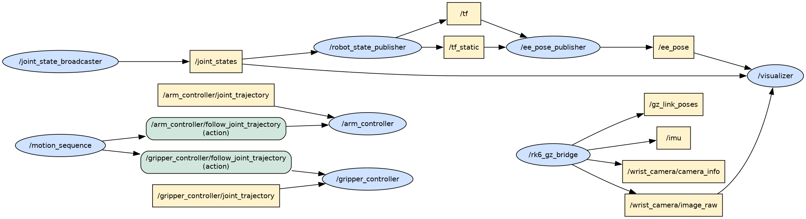

> **Şekil 9:** Hareket demosu sırasında (motion_sequence çalışırken) ROS 2 graf API'sinden çıkarılan node/topic/action diyagramı (rqt_graph eşdeğeri; mavi elips node, sarı kutu topic, yeşil kutu action). `joint_state_broadcaster` → `/joint_states` → `robot_state_publisher` → `/tf` → `ee_pose_publisher` → `/ee_pose` → `visualizer`; kamera görüntüsü `rk6_gz_bridge` üzerinden `visualizer`'a gelir; `motion_sequence` iki `follow_joint_trajectory` action'ının istemcisidir. Okunabilirlik için `/clock`, `controller_manager` istatistik/introspection topic'leri ve `controller_state` topic'leri çıkarıldı; tam graf `rapor/sonuclar/sekil7_node_topic_grafi_tam.gv` dosyasındadır.

Kurulum ve çalıştırma komutları depodaki `CALISTIRMA_KILAVUZU.md` ve `ros2_ws/README.md` dosyalarındadır.

---

## 8. Sonuç

Bu projede Fusion 360'ta kendi tasarladığım 6 serbestlik dereceli `rk6` robot kolu, CAD modelinden türetilen mesh'ler ve kinematikle URDF/Xacro olarak modellendi, Gazebo Jetty'de simüle edildi ve ROS 2 Lyrical üzerinden kontrol edildi.

**Model ve sınıflandırma.** `rk6` altı döner eklemli bir seri koldur. İlk üç eklemine göre geometrik sınıfı **R ⊢ R ∥ R** (articulated) olur; tam zincir R ⊢ R ∥ R ⊢ R ⊢ R ⊢ R'dir. Dirsekte +65.2 mm, bilekte −66.0 mm yanal kaçıklık vardır; bilekteki kaçıklık yüzünden bilek küresel değildir. Eklem çerçeveleri standart DH kuralına göre yerleştirildi ve ${}^0T_6 = A_1 A_2 \cdots A_6$ düz kinematik denklemi çıkarıldı. URDF zinciri ile ${}^0T_6$ arasındaki fark sayısal olarak $10^{-16}$ mertebesindedir; dışa aktarma pozunda model, Fusion'daki eklem noktalarıyla 0.1 mm içinde örtüşür.

**Hata analizi.** On test konfigürasyonunda (T1–T10) DH ile hesaplanan uç efektör konumu, Gazebo'nun ölçtüğü konumla karşılaştırıldı. Öklid hatasının ortalaması $\bar e = 0.245$ µm ($2.45 \times 10^{-4}$ mm), standart sapması $\sigma_e = 0.137$ µm, en büyük değeri 0.493 µm'dir. Hataların mikrometre altında ve konfigürasyondan bağımsız küçük kalması, matematiksel modelin simülasyondaki robotla aynı geometriye sahip olduğunu gösterir. Eklem takip hatası çıkarıldığında sonuç neredeyse değişmez (0.242 µm); kalan fark büyük olasılıkla fizik motorunun sayısal çözümünden gelir. Gerçek kolda montaj toleransları, servo boşluğu ve kalibrasyon nedeniyle hata milimetre düzeyine çıkacaktır; simülasyonda bu etkiler bulunmadığından elde edilen değer, modelin tutarlılığının bir ölçüsüdür.

**Sensörler ve kontrol.** Eklem durumları `/joint_states` (100 Hz), uç efektörün tabana göre konumu `/ee_pose` (20 Hz), bilek kamerası `/wrist_camera/image_raw` (≈30 Hz) ve IMU `/imu` (100 Hz) topic'lerinden okundu. Eklemler hem topic (`/arm_controller/joint_trajectory`) hem action (`/arm_controller/follow_joint_trajectory`) ile, radyan cinsinden hedeflerle hareket ettirildi. Kendi yazdığım `motion_sequence` node'u robotu Home → K1 → K2 → K3 → Home sırasıyla götürdü; ayrı bir `visualizer` node'u eklem açılarını grafikte ve kamera görüntüsünü pencerede gösterdi. Gripper metre cinsinden hedeflerle açılıp kapatıldı.

**Ek çalışma.** Ayrı bir senaryoda Jacobian tabanlı sayısal ters kinematik yazıldı. Bilek kamerasıyla yerdeki üç küp taramada ~2 mm hassasiyetle bulundu, üstüne gelince yeniden ölçülerek yaw açısı düzeltildi, gripper ile alınıp robotun önüne üç kat üst üste dizildi (katlar hedefin 5 mm içinde).

---

## Kaynaklar

1. J. J. Craig, *Introduction to Robotics: Mechanics and Control*, Pearson.
2. M. J. Mataric, *The Robotics Primer*, MIT Press.
3. ROS 2 Lyrical Dokümantasyonu, https://docs.ros.org/en/lyrical/
4. ros2_control / gz_ros2_control (Lyrical), https://control.ros.org/lyrical/
5. Gazebo Jetty Dokümantasyonu, https://gazebosim.org/docs/jetty/
6. N. Altuntaş, BLMU7619 Ders Notları (Ders 1, 2, 4; Uygulama 1–2).
